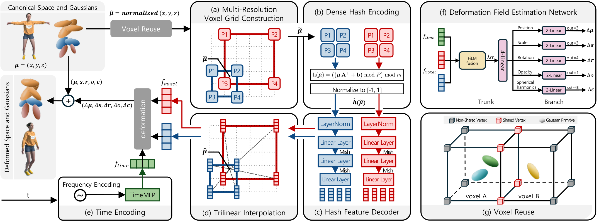

<h1 align="center">[TVCG 2026] CC-4DGS: Computational Deformation and Point-Cloud Compression for Storage-Efficient Dynamic Gaussian Splatting</h1>

<p align="center">
  <a href="mailto:kdpark@hanyang.ac.kr">Kyungdae Park</a><sup>1</sup>
  &nbsp;&nbsp;
  <a href="mailto:crhee@hanyang.ac.kr">Chae Eun Rhee</a><sup>2</sup>
</p>

<p align="center">
  <sup>1</sup>Department of Artificial Intelligence Semiconductor Engineering, Hanyang University<br>
  <sup>2</sup>Department of Electronic Engineering, Hanyang University
</p>

<p align="center"><strong>IEEE Transactions on Visualization and Computer Graphics (TVCG), 2026</strong></p>

<p align="center">
  <a href="https://arxiv.org/abs/2609.02184">arXiv</a> |
  <a href="https://ieeexplore.ieee.org/document/11643605">IEEE Xplore</a> |
  <a href="https://drive.google.com/drive/folders/1wSE9Nn9Xo8flSjNXRZsqgGDnOYsqV6qV?usp=drive_link">Pretrained Models</a>
</p>

<p align="center"><strong>Official research implementation</strong></p>

<p align="center">
  <a href="#installation">Installation</a> |
  <a href="#datasets">Datasets</a> |
  <a href="#training">Training</a> |
  <a href="#rendering-and-metrics">Rendering</a> |
  <a href="#cca-compression">Compression</a>
</p>

<p align="center">
  
</p>

<p align="center"><em>Architecture of the Computational Deformation Field (CDF). CDF synthesizes multi-resolution deformation features on demand using dense hash encoding and compact neural decoders instead of storing trainable hash-feature tables.</em></p>

## Overview

CC-4DGS addresses the two primary storage bottlenecks of dynamic Gaussian
splatting while preserving high reconstruction quality and real-time rendering:

- **Computational Deformation Field (CDF)** replaces trainable multi-resolution
  hash-feature tables with deterministic dense hash encodings and compact MLP
  decoders that synthesize deformation features on demand.
- **Compression of Canonical point-cloud Attributes (CCA)** combines a
  conditional autoencoder for high-order spherical-harmonic attributes, a
  residual codebook, and attribute-specific quantization.

This repository provides the manuscript's default training, rendering,
evaluation, and CCA compression pipeline together with the scene-specific
configurations used for N3DV and Technicolor.

## Contents

```text
arguments/                         N3DV and Technicolor scene configurations
gaussian_renderer/                 Rendering interface
scene/                             CDF, Gaussian model, and dataset loaders
tools/rest_autoencoder.py          CCA autoencoder and compressed bundle writer
tools/restfree_quant_pack.py       Attribute-specific quantization
tools/rest_auto_plus_quant.sh      End-to-end CCA compression/evaluation command
tools/report_model_size.py         Raw and deployable model-size report
submodules/diff-gaussian-rasterization/
                                    Vendored Gaussian rasterizer
submodules/simple-knn/              Upstream simple-knn Git submodule
train.py                           Training entry point
render.py                          Raw or compressed checkpoint renderer
metrics.py                         PSNR/SSIM evaluation
```

## Installation

The code was validated with Ubuntu 22.04.5 LTS, Python 3.8, PyTorch 2.0.0+cu118,
CUDA 11.8, and an NVIDIA RTX 4090 GPU.
The CUDA toolkit used to compile the rasterizer should be compatible with the
installed PyTorch build.

```bash
git clone --recursive https://github.com/KyungdaePark/CC-4DGS.git
cd CC-4DGS

conda create -n cc4dgs python=3.8 -y
conda activate cc4dgs

# Ensure nvcc and a compatible C++ compiler are available before this step.
pip install --upgrade pip setuptools wheel ninja
pip install -r requirements.txt
```

If the repository was cloned without `--recursive`, initialize its external
dependencies with `git submodule update --init --recursive` before installing
the requirements.

The requirements build the included Gaussian rasterizer and `simple-knn` as
editable CUDA extensions.

Verify the main imports:

```bash
python -c "import torch, diff_gaussian_rasterization, simple_knn; print(torch.__version__)"
python train.py --help
python render.py --help
```

## Datasets

Dataset files are not included. We follow the dataset download, directory
layout, and preprocessing protocol from
[Wu et al.'s official 4DGaussians repository](https://github.com/hustvl/4DGaussians).
After preparing a scene according to that repository, select the corresponding
configuration under `arguments/dynerf/` or `arguments/technicolor/`.

## Pretrained Models

The manuscript-default CC-4DGS checkpoints are available from
[Google Drive](https://drive.google.com/drive/folders/1wSE9Nn9Xo8flSjNXRZsqgGDnOYsqV6qV?usp=drive_link).
The release includes the exact scene-specific checkpoints used for manuscript
evaluation:

- `CC-4DGS_N3DV_CDF/`: raw CDF checkpoints for the six N3DV scenes.
- `CC-4DGS_N3DV_CDF_CCA/`: deployable CDF+CCA checkpoints for the same six
  scenes.
- `CC-4DGS_Technicolor_CDF/`: raw CDF checkpoints for the five Technicolor
  scenes.
- `CC-4DGS_Technicolor_CDF_CCA/`: deployable CDF+CCA checkpoints for the same
  five scenes.

The CDF directories contain `point_cloud.ply` and `deformation.pth`. The
CDF+CCA directories contain the CCA `compressed/` bundle and the same
`deformation.pth`; a raw PLY is not required when rendering with
`--compressed`. Use an extracted scene directory as `MODEL` in the rendering
commands below. The selected checkpoint iteration and exact deployable byte
count for each scene are recorded in `manifests/checkpoints.csv` in the Drive
release.

## Training

Select the config that matches the scene name. The scene files inherit the
complete method and optimization settings from their local defaults.

N3DV example:

```bash
SCENE=cut_roasted_beef
DATA=/path/to/N3DV/$SCENE
MODEL=outputs/n3dv/$SCENE
CONFIG=arguments/dynerf/$SCENE.py

CUDA_VISIBLE_DEVICES=0 python train.py \
  --source_path "$DATA" \
  --model_path "$MODEL" \
  --configs "$CONFIG" \
  --expname "$SCENE"
```

Technicolor example:

```bash
SCENE=Birthday
DATA=/path/to/technicolor/$SCENE
MODEL=outputs/technicolor/$SCENE
CONFIG=arguments/technicolor/$SCENE.py

CUDA_VISIBLE_DEVICES=0 python train.py \
  --source_path "$DATA" \
  --model_path "$MODEL" \
  --configs "$CONFIG" \
  --expname "$SCENE"
```

Training writes checkpoints under:

```text
<model>/point_cloud/iteration_<N>/
  point_cloud.ply
  deformation.pth
```

The complete training procedure includes coarse initialization, dynamic/static
decomposition, and the scene-configured main optimization stage.

## Rendering and Metrics

Set `ITER` to the checkpoint to evaluate. The snippet below selects the highest
available checkpoint iteration under `$MODEL`, renders its test views, and
computes PSNR/SSIM.

```bash
ITER=$(
  find "$MODEL/point_cloud" -maxdepth 1 -type d -name 'iteration_*' -printf '%f\n' |
  sed 's/^iteration_//' |
  sort -n |
  tail -1
)
test -n "$ITER" || { echo "No checkpoint found under $MODEL/point_cloud"; exit 1; }

CUDA_VISIBLE_DEVICES=0 python render.py \
  --source_path "$DATA" \
  --model_path "$MODEL" \
  --configs "$CONFIG" \
  --iteration "$ITER" \
  --skip_train \
  --skip_video

MPLBACKEND=Agg CUDA_VISIBLE_DEVICES=0 python metrics.py \
  --model_paths "$MODEL" \
  --iteration "$ITER"
```

Raw test renders are written to
`<model>/test/ours_best_<N>/`. The evaluator writes aggregate metrics to
`results.json` and per-view values to `per_view.json`.

## CCA Compression

The end-to-end command trains the CCA autoencoder, writes the compressed
canonical-attribute bundle, renders it through the compressed loader, and
evaluates the result:

```bash
ITER=$(
  find "$MODEL/point_cloud" -maxdepth 1 -type d -name 'iteration_*' -printf '%f\n' |
  sed 's/^iteration_//' |
  sort -n |
  tail -1
)
test -n "$ITER" || { echo "No checkpoint found under $MODEL/point_cloud"; exit 1; }

CUDA_VISIBLE_DEVICES=0 bash tools/rest_auto_plus_quant.sh \
  --model "$MODEL" \
  --source-iter "$ITER" \
  --iteration "$ITER" \
  --dataset "$DATA" \
  --config "$CONFIG"
```

This command uses the CCA-Default settings reported in the paper and processes
one scene at a time. The manuscript's N3DV CCA results, including the reported
total deployable model size, are averages over the six manuscript checkpoints;
reproducing those table values therefore requires the same scene-specific
checkpoints and evaluation iterations followed by six-scene averaging. Because
the CCA autoencoder and residual codebook are trained during this command,
small run-to-run numerical differences may occur.

The command writes new artifacts to `<model>/autoencoder/iteration_<N>/` and
`<model>/point_cloud/iteration_<N>/compressed/`. It does not remove the staging
autoencoder directory by default and does not overwrite an existing PLY unless
`--overwrite` is explicitly forwarded. Use `--cleanup-autoencoder` only when
the staging files are no longer needed.

To run rendering and metrics separately:

```bash
CUDA_VISIBLE_DEVICES=0 python render.py \
  --source_path "$DATA" \
  --model_path "$MODEL" \
  --configs "$CONFIG" \
  --iteration "$ITER" \
  --skip_train \
  --skip_video \
  --compressed

MPLBACKEND=Agg CUDA_VISIBLE_DEVICES=0 python metrics.py \
  --model_paths "$MODEL" \
  --iteration "$ITER" \
  --compressed
```

Compressed renders are written to
`<model>/test/ours_best_<N>_compressed/`.

## Model Size

Report raw storage, CCA canonical-attribute storage, Deform-module storage, and
total deployable storage with:

```bash
python tools/report_model_size.py --model "$MODEL" --iteration "$ITER"
```

The paper reports decimal megabytes (`1 MB = 1,000,000 bytes`). The tool prints
decimal MB, binary MiB, and exact bytes to make the convention explicit. Total
deployable model size is the compressed canonical-attribute bundle plus the
Deform-module checkpoint required for rendering.

## Hugging Face Space (ZeroGPU)

`space/` contains a Gradio viewer that renders CDF and CDF+CCA checkpoints on a
[ZeroGPU](https://huggingface.co/docs/hub/spaces-zerogpu) Space (training is not
part of the Space). Only rendering requests the GPU; PLY/CCA decoding and the CDF
network setup run on CPU.

```bash
git submodule update --init --recursive
pip install huggingface_hub
HF_TOKEN=hf_xxx python space/deploy.py --space-id <user>/CC-4DGS
```

`deploy.py` copies the inference code and `space/` into one folder, uploads it,
and requests the `zero-a10g` (ZeroGPU) hardware. Use `--stage-dir <dir>` without
`--space-id` to only assemble the folder. The same step runs from GitHub Actions
through the manual workflow `.github/workflows/deploy-hf-space.yml` (repository
secret `HF_TOKEN`).

The Space runs Python 3.10 with `torch==2.8.0` (CUDA 12.8). The rasterizer and
`simple-knn` are installed from the prebuilt wheels in `space/wheels/`
(sm_80/86/89/90). Rebuild them with `bash space/build_wheels.sh` after a torch
change; no GPU is needed. When the wheels do not match the installed torch, the
app compiles the extensions at start-up with a CUDA toolkit that it downloads
from NVIDIA's redistributable archives.

To render a scene, upload a zip of the scene folder or enter a Hugging Face repo
and subfolder that holds `point_cloud/iteration_<N>/`. Add `poses_bounds.npy`
(N3DV) or COLMAP `images.bin` + `cameras.bin` (Technicolor) to render from the
dataset cameras and the spiral path; without them the app uses an orbit.

## Reproduction Notes

- Use the scene-specific config shipped in `arguments/`; several N3DV scenes
  use different CDF capacities and optimization schedules.
- Compare raw and compressed metrics from the same checkpoint iteration and
  test-camera split.
- `residual_codebook.npy` and `residual_assignments.npy` are both required to
  reconstruct the residual correction used by the CCA bundle.

## License

Original CC-4DGS code is licensed under the [Apache License 2.0](LICENSE.md).
Files derived from 3D Gaussian Splatting, 4DGaussians, and other upstream
projects retain their original copyright notices and license terms. In
particular, the Inria Gaussian Splatting code and CUDA extensions included in
this repository are restricted to non-commercial research and evaluation use;
the root Apache-2.0 license does not override those terms. See
[THIRD_PARTY_NOTICES.md](THIRD_PARTY_NOTICES.md) and the license files and
source headers under `submodules/` before redistribution or commercial use.

## Citation

If you find this work useful, please cite:

```bibtex
@article{park2026cc4dgs,
  author  = {Park, Kyungdae and Rhee, Chae Eun},
  title   = {{CC-4DGS}: Computational Deformation and Point-Cloud Compression for Storage-Efficient Dynamic Gaussian Splatting},
  journal = {IEEE Transactions on Visualization and Computer Graphics},
  year    = {2026},
  eprint  = {2609.02184},
  archivePrefix = {arXiv},
  primaryClass  = {cs.CV},
  doi     = {10.1109/TVCG.2026.3721136},
  url     = {https://doi.org/10.1109/TVCG.2026.3721136}
}
```
